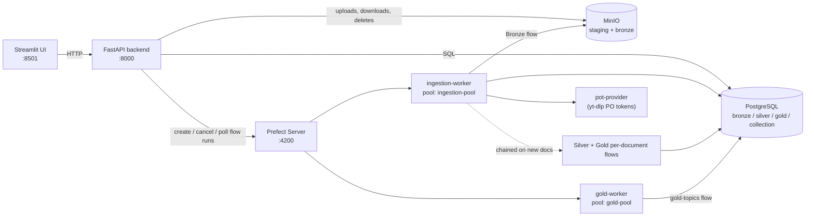

# Political Speeches Analytics Pipeline

An end-to-end data engineering and NLP application that **collects** political speeches (text, audio, video), **tracks** every collection run, **transcribes and cleans** the content, and **analyzes** the resulting corpus (linguistics, entities, sentiment, emotions, themes, topics).

The current case study is a corpus of public content by **Donald Trump** (speeches, interviews, tweets / Truth Social posts). The speaker is set automatically for this corpus. The code itself is source-agnostic: new sources plug in through a registry.

> **Branch note:** this README describes the `collection-redesign` branch (run-based collection, discovery log, Documents page, YouTube playlists, separate Prefect work pools).

---

## Table of contents

1. [Features](#features)
2. [Architecture](#architecture)
3. [Quick start (Docker Compose)](#quick-start-docker-compose)
4. [Configuration](#configuration)
5. [How a collection run works](#how-a-collection-run-works)
6. [Sources](#sources)
7. [Silver: text extraction and transcription](#silver-text-extraction-and-transcription)
8. [Gold: analytics](#gold-analytics)
9. [Web interface](#web-interface)
10. [Backend API](#backend-api)
11. [Data model](#data-model)
12. [Prefect deployments and workers](#prefect-deployments-and-workers)
13. [Local development without Docker](#local-development-without-docker)
14. [Tests](#tests)
15. [Repository layout](#repository-layout)
16. [Troubleshooting](#troubleshooting)
17. [Security and limitations](#security-and-limitations)

---

## Features

- **Run-based collection**: every submission creates a *run* with a status (`queued`, `running`, `completed`, `completed_with_errors`, `failed`, `cancelled`), timing, and a per-URL **discovery log** that explains why each candidate was ingested, skipped, rejected or failed.
- **Single-document and archive modes**: one file/URL/video at a time, or bounded collections (Miller Center, UCSB, YouTube playlists, web crawl).
- **Dry run**: records what *would* be collected, downloads nothing.
- **Cancel and relaunch** runs from the UI; stuck runs are **reconciled** against Prefect on read.
- **Deduplication** by canonical URL (before download) and by SHA-256 checksum (after download).
- **Raw storage in MinIO**, structured data in PostgreSQL, medallion layout (Bronze / Silver / Gold).
- **Transcription** with faster-whisper, HTML extraction with Trafilatura and site-specific parsers, automatic language detection for text.
- **Per-document NLP**: lexical and syntactic metrics, named entities, sentiment, emotion, zero-shot labels.
- **Corpus-level topic modeling** (BERTopic) triggered from the UI.
- **Document library**: browse, preview text, edit metadata, download raw file / transcript, delete everywhere (database + object storage).
- **Bronze → Silver → Gold chaining**: a Bronze run automatically processes the documents it just ingested.

---

## Architecture



Design rules worth knowing:

| Rule | Why |
|---|---|
| The **backend never imports `prefect` or `prefect_flows`**. It talks to the Prefect HTTP API only. | Keeps the backend/Streamlit environment compatible with `anyio>=4`; Prefect 2 pins `anyio<4`. A test enforces this. |
| The only contract between backend and flows is **JSON params + enum values + the database schema**. | `tests/test_backend_contract.py` fails if either side drifts. |
| Three separate Python environments: flows (`requirements.txt`), backend (`backend/requirements.txt`), frontend (`frontend/requirements.txt`). | Dependency conflicts (see above). |
| The source adapters yield **candidates lazily**, one at a time. | Large collections are never held in memory. |
| Source-specific code lives in `prefect_flows/sources/` and `prefect_flows/extractors/`; the flow and the backend schemas stay generic. | A test asserts the flow module contains no source-specific code. |

---

## Quick start (Docker Compose)

### Prerequisites

- Git, Docker Engine / Desktop with Compose v2
- (Optional) NVIDIA GPU + driver + Docker GPU runtime for fast transcription

### 1. Clone

```bash
git clone --branch collection-redesign https://github.com/Si-Rin/political-speeches-analytics-pipeline.git
cd political-speeches-analytics-pipeline
```

### 2. Create `.env`

```dotenv
MINIO_ROOT_USER=change_me
MINIO_ROOT_PASSWORD=change_me_too
POSTGRES_USER=change_me
POSTGRES_PASSWORD=change_me_too
POSTGRES_DB=political_speeches
```

Never commit this file (it is in `.gitignore`).

### 3. Start

```bash
docker compose up -d --build
docker compose ps
docker compose logs -f prefect-deploy      # one-shot: creates pools and registers deployments
```

`minio-init` and `prefect-deploy` exit after finishing; an `Exited (0)` status is normal.

### 4. Open

| Service | URL |
|---|---|
| Streamlit UI | http://localhost:8501 |
| FastAPI (docs at `/docs`) | http://localhost:8000 |
| Prefect UI | http://localhost:4200 |
| MinIO console | http://localhost:9001 |
| PostgreSQL (from host) | `localhost:5433` |

### 5. First run

1. Open **Collection**, pick *Single document* → *Direct URL* (or any source), submit.
2. Follow it on **Runs** (status, outcomes, discovery log).
3. Once Silver/Gold finish, see it in **Documents**, **Overview**, **Sentiment & Entities**.
4. With **20+ processed documents** in a group, use **Topics & Labels → Compute topics now**.

### Compose services

| Service | Role |
|---|---|
| `minio`, `minio-init` | Object storage; init creates buckets `bronze` and `staging` (staging objects expire after 1 day) |
| `postgres` | PostgreSQL 16; runs `init_scripts/postgres/*.sql` on first start (also creates the `prefect` database) |
| `prefect-server` | Orchestration API and UI |
| `prefect-deploy` | One-shot: creates `ingestion-pool` and `gold-pool`, registers the `bronze-ingestion` and `gold-topics` deployments |
| `pot-provider` | Proof-of-origin token provider used by yt-dlp for YouTube |
| `ingestion-worker` | Runs Bronze ingestion and the chained Silver/Gold flows (`mem_limit: 4g`) |
| `gold-worker` | Runs the corpus-level topic modeling |
| `backend` | FastAPI |
| `frontend` | Streamlit |

---

## Configuration

`docker-compose.yml` is the source of truth for the Docker setup. Main variables:

| Variable | Used by | Purpose / default |
|---|---|---|
| `MINIO_ROOT_USER`, `MINIO_ROOT_PASSWORD` | all | MinIO credentials |
| `MINIO_ENDPOINT` | backend, workers | `minio:9000` in Compose |
| `MINIO_STAGING_BUCKET`, `MINIO_BRONZE_BUCKET` | backend, flows | `staging`, `bronze` |
| `MINIO_STAGING_EXPIRY_DAYS` | backend | `1` |
| `POSTGRES_HOST`, `POSTGRES_PORT`, `POSTGRES_DB`, `POSTGRES_USER`, `POSTGRES_PASSWORD` | backend, workers | `postgres:5432` in Compose |
| `PREFECT_API_URL` | backend, workers | `http://prefect-server:4200/api` |
| `PREFECT_FLOW_NAME`, `PREFECT_DEPLOYMENT_NAME` | backend | `bronze-ingestion`, `default` |
| `PREFECT_TOPICS_FLOW_NAME` | backend | `gold-topics` (its deployment name reuses `PREFECT_DEPLOYMENT_NAME`) |
| `PREFECT_DEPLOYMENT_ID` | backend | optional: skip name lookup for the Bronze deployment |
| `PREFECT_API_TIMEOUT` | backend | seconds, default `10` |
| `MAX_UPLOAD_BYTES` | backend | default 1 GiB (also `maxUploadSize = 1000` MB in `frontend/.streamlit/config.toml`) |
| `API_BASE_URL` | frontend | `http://backend:8000` in Compose, `http://localhost:8000` otherwise |
| `YTDLP_POT_URL` | workers | `http://pot-provider:4416` |
| `WHISPER_DEVICE`, `WHISPER_COMPUTE_TYPE` | workers | `cuda` / `float16` in Compose; defaults `auto` / auto-chosen |
| `WORK_DIR`, `WORK_MAX_BYTES` | workers | temp directory and per-run size cap for downloads |
| `MAX_DOWNLOAD_BYTES` | workers | per-file download cap |
| `FETCH_DELAY_SECONDS` | workers | per-host politeness delay, default `1.0` |
| `SCRAPER_CONTACT` | flows | contact address put in the crawler `User-Agent` |

GPU note: setting `WHISPER_DEVICE=cuda` only works if the container can actually see a GPU. If the Compose file has no `deploy.resources.reservations.devices` block for `ingestion-worker`, add one (or use `WHISPER_DEVICE=cpu`).

---

## How a collection run works

```
Streamlit form
  └─ POST /runs  (source-specific request, validated by Pydantic, extra fields forbidden)
       ├─ backend.prefect_params: user-level fields → flow params (pure function)
       ├─ INSERT collection.runs (status = queued)
       └─ Prefect: create_flow_run(run_id, source_name, params, params_version, dry_run)
            └─ ingest_bronze → run_collection
                 ├─ registry validates params with the flow-side models
                 ├─ source.candidates()    (lazy stream)
                 └─ for each candidate: ingest_candidate
                      1. known canonical URL?  → known_url_skipped
                      2. dry run?              → prefilter_passed
                      3. materialize into a scoped temp dir (HTTP download / staged upload / local path)
                      4. SHA-256, size budget check
                      5. checksum already in Bronze? → duplicate_content
                      6. upload to MinIO `bronze`
                      7. INSERT bronze.documents   (lost race → duplicate_content)
                      8. record the outcome in bronze.discovery_log
            └─ finalize run: completed / completed_with_errors / failed / cancelled
            └─ chain Silver → Gold (sentiment, linguistic, labels) on the new doc_ids
```

### Run statuses

| Status | Meaning |
|---|---|
| `queued` | Row created, waiting for a worker |
| `running` | Flow is processing candidates |
| `completed` | Finished, no fetch/ingest errors |
| `completed_with_errors` | Finished, but some candidates failed to download or store |
| `failed` | Unhandled error (bad params, source error, Prefect outage) |
| `cancelled` | Cancelled by the user or in Prefect |

### Candidate outcomes (discovery log)

`ingested`, `duplicate_content`, `known_url_skipped`, `prefilter_passed` (dry run), `prefilter_rejected`, `content_rejected`, `fetch_failed`, `ingest_failed`, each with an optional reason code (`http_error`, `timeout`, `content_too_large`, `access_restricted`, `robots_disallowed`, `checksum_exists`, `upload_failed`, `db_error`, …). The Python enums and the SQL `CHECK` constraints must list the same values; `tests/test_enums_sql.py` verifies it.

### Reliability mechanisms

- **Reconciliation on read**: `GET /runs/{id}` compares a non-terminal row with the Prefect flow-run state. A crashed/failed flow marks the run `failed`, a cancelled flow marks it `cancelled`, a run never handed to Prefect fails after 10 minutes. It never overwrites a result the flow already recorded.
- **Prefect outage on submit**: the run row is created, marked `failed`, and the API answers `502` with the `run_id`.
- **Temp files**: each candidate gets its own scope directory; the producer releases what it does not yield, the consumer releases what it receives. Stale run directories (24 h) are swept.
- **Politeness**: per-host delay, `robots.txt` for crawls, retries with backoff on 429/5xx, size caps.
- **Uploads**: browser uploads go to the MinIO `staging` bucket first (a worker cannot read a browser's local path). The flow deletes the staged object after use; a 1-day expiry rule is the backstop.

---

## Sources

Sources are registered in `prefect_flows/sources/registry.py`. Adding one = a params model + an adapter + one `SourceSpec`.

| Source | Mode | UI | Notes |
|---|---|---|---|
| `local_file` | single | Collection → Single → Local file | Upload to MinIO `staging`, then ingested. |
| `direct_url` | single | Direct URL | One media/text file link, with optional **Preview** (HEAD / title probe). Not for YouTube or archive.org. |
| `youtube` | single | YouTube | One video, video or audio-only. |
| `youtube_collection` | archive | Archive → YouTube playlist | Playlist or channel page, first *N* videos (default 10, max 200), audio-only by default. |
| `internet_archive` | single | Internet Archive | One `archive.org/details/<id>` item, collected as audio. Segment exclusions (`excluded_indices`) are only available through CLI/params, see `ia_excluded_indices_example.json`. |
| `miller_center` | archive | Archive → Miller Center | Speech page URLs, or a listing page (filters in the URL are preserved, pagination followed). |
| `ucsb` | archive | Archive → UCSB | American Presidency Project listing. The URL must contain `first-term` (→ "Tweets of …") or `second-term` (→ "Truth Social Posts of …"); the link-text filter is derived from it. |
| `web_crawl` | archive | Archive → Web crawl (Advanced) | Seed URLs + keywords, allowed domains, depth 2–5, max pages 1–500. |
| `local_folder` | single | none (CLI/dev only) | Ingest every supported file in a folder. |
| `internet_archive_collection` | archive | not implemented | Enum value reserved. |

**Optional metadata** (title, publication date, language, notes) typed in single-document forms is stored as `raw_metadata.user_provided` and **overrides** what the extractors detect. The language also drives Whisper.

### Deduplication

Two independent checks:

1. **URL**: for `http(s)` candidates the pipeline looks up the canonical URL (lowercased host, default ports and tracking parameters removed, query sorted, trailing slash trimmed) in Bronze before downloading.
2. **Content**: SHA-256 checksum, enforced by a `UNIQUE` constraint on `bronze.documents.checksum`.

A run that only finds already-known URLs is not a failure: check its outcome counts on the Runs page.

### Command line

```bash
python -m prefect_flows.cli --list
python -m prefect_flows.cli --source direct_url --params '{"url": "https://host/x.mp3", "content_type": "audio"}'
python -m prefect_flows.cli --source local_folder --params '{"folder": "/data/speeches"}' --dry-run
python -m prefect_flows.cli --source ucsb --params-file ucsb.json --run-id <uuid>
```

---

## Silver: text extraction and transcription

`prefect_flows/silver_ingest.py` processes every Bronze document that has no successful Silver row.

| Content | Extractor | Method |
|---|---|---|
| Audio / video | `AudioVideoExtractor` | faster-whisper (`medium`), with a domain prompt built from title/description |
| Miller Center page | `MillerCenterExtractor` | CSS selectors on the speech page |
| UCSB page | `UcsbExtractor` | Structural detection: *Tweets* format vs *Truth Social* format; retweets/reposts, link-only posts, @mentions, URLs and hashtags removed |
| Internet Archive item | `InternetArchiveExtractor` | Slices the audio by non-excluded segments, transcribes each slice separately |
| Any other HTML | `GenericHtmlExtractor` | Trafilatura, with title fallbacks |

The extractor is chosen by `raw_metadata.source_name` (exact enum match), then by URL domain, then generic. User-typed title and publication date win over detected values.

**Language**: Whisper accepts the researcher's language (ISO code or common English name, from a fixed allow-list: en, fr, ar, es, de, it, pt, tr, ru, uk, zh, ja, ko, hi; default `en`). For text, the language is detected with `langdetect`.

Results go to `silver.text` (`transcript`, `word_count`, `title`, `publication_date`, `language`, `status_processing`, `error_message`). A missing Bronze object marks the document `failed` instead of retrying forever.

---

## Gold: analytics

Results are stored as JSONB columns in `gold.analytics`. Each flow writes **only its own columns** (`INSERT … ON CONFLICT DO UPDATE` on the given columns), so flows never overwrite each other.

| Stage | Flow | Output columns | Scope |
|---|---|---|---|
| A | `gold-linguistic-metrics` | `lex_metrics`, `syntactic_metrics`, `entities` | per document, one shared spaCy parse (`en_core_web_sm`) |
| B | `gold-sentiment-emotion` | `sentiment`, `emotions` | per document |
| B | `gold-labels` | `labels` | per document |
| C | `gold-topics` | `topics`, `keywords` | **corpus-level** |

**Stage A**
- *Lexical*: pronoun ratios per 1,000 words, top content words, bigrams/trigrams, anaphora (repeated sentence openings), binary oppositions (freedom/tyranny, …), TTR and MTLD.
- *Syntactic*: sentence stats, modality (obligation / possibility / certainty), POS distribution, verb tense.
- *Entities*: spaCy NER grouped into persons, organizations, groups (NORP), locations, dates, other.

**Stage B** (all long texts are chunked against each model's real tokenizer limit)
- Sentiment: `cardiffnlp/twitter-roberta-base-sentiment-latest` (3 classes). Chunk distributions are combined with a length-weighted **average**.
- Emotion: `j-hartmann/emotion-english-distilroberta-base` (7 classes), same aggregation.
- Labels: `facebook/bart-large-mnli` zero-shot, 12 policy labels, multi-label, **max** over chunks, threshold 0.5 (the best label is always kept).

**Stage C: topics**
- Embeddings: `sentence-transformers/all-mpnet-base-v2`, chunk embeddings averaged by token count.
- BERTopic (UMAP seeded, HDBSCAN, `min_topic_size = 10`, c-TF-IDF keywords, 1–2-grams).
- The corpus is split in two and fitted **separately**: *long-form* (≥ 500 words) and *short-form* (< 500 words, tweets/posts). Each group needs **at least 20 documents** (`MIN_DOCS_FOR_TOPIC_MODELING`).
- Every run **refits from scratch**: topic IDs and assignments can change when documents are added. Topic `-1` is BERTopic's outlier bucket.
- Constants are duplicated in `backend/routes/topics_run.py` (the backend does not import the flows). Keep them in sync.

Per-document Gold flows run automatically after a Bronze run. They can also be run by hand:

```bash
python prefect_flows/silver_ingest.py --limit 10
python prefect_flows/gold_linguistic.py --doc-ids 1 2 3
python prefect_flows/gold_sentiment.py
python prefect_flows/gold_labels.py
python prefect_flows/gold_topics.py
```

---

## Web interface

Streamlit, multi-page (`frontend/app.py` defines the navigation).

| Page | What it does |
|---|---|
| **Overview** | Corpus at a glance, headline findings, tone, keywords/n-grams, entities, rhetoric (pronouns, oppositions, TTR), themes, collection statistics |
| **Collection** | Mode (Single / Archive) → source → form. Single forms include optional metadata and a Preview step where supported |
| **Runs** | Run list with status filter; per-run metrics, outcome breakdown and reasons, documents created with their Bronze → Silver → Gold state, filterable discovery log, **Cancel** and **Relaunch** buttons; auto-refresh while a run is active |
| **History** | Table of collected documents, filter by content type |
| **Documents** | Document library (metadata, processing state, Gold progress), text preview, metadata editing, raw/transcript download, deletion. Backed by the `/documents/library`, `/detail`, `/text`, `/metadata`, `/delete` endpoints |
| **Sentiment & Entities** | Sentiment/emotion distributions, sentiment over time, most frequent persons/locations/groups |
| **Topics & Labels** | "Compute topics now" control with progress toward the 20-document minimum, BERTopic topics per corpus, topic ↔ label cross-validation (purity, lift), label distribution |

Shared helpers: `frontend/api_client.py` (all backend calls; returns `None` after showing an error), `frontend/components/` (forms, metadata fields, altair charts).

---

## Backend API

FastAPI, interactive docs at `http://localhost:8000/docs`.

| Area | Endpoints |
|---|---|
| Health | `GET /health` |
| Runs | `POST /runs`, `GET /runs`, `GET /runs/{id}`, `GET /runs/{id}/log`, `POST /runs/{id}/cancel`, `POST /runs/{id}/retry` |
| Uploads | `POST /uploads` (multipart → `staging_key`) |
| Documents | `POST /documents/probe`, `GET /documents/history`, `GET /documents/library`, `GET /documents/{id}`, `GET /documents/{id}/detail`, `GET /documents/{id}/text`, `GET /documents/{id}/download`, `GET /documents/{id}/transcript`, `PATCH /documents/{id}/metadata`, `POST /documents/delete` |
| Pipeline status | `GET /status`, `GET /status/{doc_id}` |
| Analytics | `GET /analytics/overview`, `/topics`, `/labels`, `/sentiment`, `/emotions`, `/entities`, `/corpus` |
| Topic modeling | `GET /analytics/topics/run` (state), `POST /analytics/topics/run` (start) |

Useful status codes: `422` invalid request (nothing created) · `502` Prefect unreachable (run created and marked failed) · `503` object storage unreachable · `409` cancel on a finished run, or a topic run already in progress · `413` upload too large.

`POST /runs` is a discriminated union on `source`; every model forbids unknown fields. Example:

```bash
curl -X POST http://localhost:8000/runs -H 'Content-Type: application/json' -d '{
  "source": "direct_url",
  "url": "https://example.com/speech.mp3",
  "content_type": "audio",
  "title": "Optional title",
  "dry_run": true
}'
```

---

## Data model

Schemas: `collection`, `bronze`, `silver`, `gold` (see `init_scripts/postgres/init_schema.sql`).

| Table | Content |
|---|---|
| `collection.runs` | One row per run: source, params (JSONB), `params_version`, `dry_run`, status, Prefect flow-run id, timings, error |
| `bronze.documents` | One row per accepted raw file: source URL/type, file name/size, MIME, **unique checksum**, MinIO path, `raw_metadata` (source metadata, provenance, `user_provided`), `excluded`, `first_run_id` |
| `bronze.discovery_log` | One row per candidate decision: status, reason code, detail, matched keywords, `doc_id`; cascades with its run |
| `silver.text` | Transcript/text, title, speaker, publication date, language, word count, processing status/error; cascades from Bronze |
| `gold.analytics` | JSONB results (`topics`, `labels`, `sentiment`, `emotions`, `entities`, `lex_metrics`, `syntactic_metrics`, `keywords`); cascades from Silver |
| `gold.v_documents_full` | View joining the three layers |

Object storage: MinIO bucket `bronze` (objects named `<sha256><ext>`) and `staging` (temporary uploads).

Deleting a document (`POST /documents/delete`) removes the Bronze row (Silver and Gold cascade) and the MinIO object, so the URL can be collected again.

> **Migrations:** files in `init_scripts/postgres/` run **only when the PostgreSQL volume is first created**. On an existing database, apply schema changes manually, for example the Silver language column:
> ```sql
> ALTER TABLE silver.text ADD COLUMN IF NOT EXISTS language VARCHAR(20);
> CREATE INDEX IF NOT EXISTS idx_silver_language ON silver.text(language);
> ```
> Or reset everything (destroys data): `docker compose down -v`.

---

## Prefect deployments and workers

`prefect-deploy` creates two **process** work pools and two deployments, both named `default`:

| Pool | Worker | Deployment | Flow |
|---|---|---|---|
| `ingestion-pool` | `ingestion-worker` | `bronze-ingestion/default` | `prefect_flows/bronze_ingest.py:ingest_bronze` |
| `gold-pool` | `gold-worker` | `gold-topics/default` | `prefect_flows/gold_topics.py:ingest_gold_topics` |

Silver and the per-document Gold flows are not separate deployments: they run inside the Bronze flow run, in the ingestion worker.

Separate pools separate **scheduling**, not resources. A process worker's flow runs are child processes, so a container memory limit may not constrain them reliably. If topic modeling still exhausts memory, consider a Docker work pool with a per-run memory limit.

---

## Local development without Docker

You still need MinIO, PostgreSQL and Prefect Server (for example `docker compose up -d minio minio-init postgres prefect-server`). Use **three separate virtual environments**.

```bash
# Flows and tests
python -m venv .venv-flows && source .venv-flows/bin/activate
pip install -r requirements.txt

# Backend
python -m venv .venv-backend && source .venv-backend/bin/activate
pip install -r backend/requirements.txt
set -a; source .env; set +a
export POSTGRES_HOST=localhost POSTGRES_PORT=5433 MINIO_ENDPOINT=localhost:9000
export PREFECT_API_URL=http://localhost:4200/api
uvicorn backend.main:app --reload --port 8000

# Frontend
python -m venv .venv-frontend && source .venv-frontend/bin/activate
pip install -r frontend/requirements.txt
API_BASE_URL=http://localhost:8000 streamlit run frontend/app.py
```

System requirements for flows: FFmpeg (audio/video), and `deno` for recent yt-dlp YouTube extraction (installed in the Dockerfiles).

---

## Tests

```bash
pytest                                   # fast unit tests, no external service needed
TEST_DATABASE_URL="host=127.0.0.1 port=5433 dbname=political_speeches user=... password=..." pytest tests/test_backend_api.py tests/test_repo_postgres.py
```

| Test file(s) | Covers |
|---|---|
| `test_backend_contract.py` | Backend payloads validate against the flow models; enums identical on both sides; backend never imports Prefect |
| `test_enums_sql.py` | Python enums = SQL `CHECK` values |
| `test_backend_api.py` | Uploads, run creation, discovery log paging, reconciliation, cancel (real PostgreSQL; Prefect and MinIO faked) |
| `test_reconcile.py` | Run-state reconciliation rules |
| `test_runner_registry.py`, `test_pipeline_cleanup.py`, `test_workarea_fetcher.py` | Run loop, temp-file cleanup on every path, fetcher politeness/retries/caps |
| `test_urls_keywords_prefilter.py` | URL canonicalization, keyword and prefilter logic |
| `test_staging_user_provided.py`, `test_phase0.py` | Staged uploads, user-provided metadata, extractor selection, Whisper language resolution |
| `tests/frontend/` | `api_client` against a fake backend, Streamlit pages via `AppTest` |

The database tests are skipped unless `TEST_DATABASE_URL` is set; the schema (`init_schema.sql`) must already be applied.

---

## Repository layout

```text
.
├── docker-compose.yml
├── prefect.yaml                      # deployment configuration (if present on the branch)
├── requirements.txt                  # flows + tests
├── init_scripts/postgres/
│   ├── 01-create-prefect-db.sql
│   └── init_schema.sql
├── backend/
│   ├── main.py                       # FastAPI app
│   ├── db.py, storage.py             # PostgreSQL, MinIO access
│   ├── pipeline_runner.py            # Prefect HTTP client
│   ├── pipeline_probe.py             # lightweight metadata probe
│   ├── prefect_params.py             # request → flow params
│   ├── reconcile.py, runs_repo.py    # run reconciliation, run SQL
│   ├── routes/                       # runs, uploads, documents, status, analytics, topics_run
│   └── schemas/                      # common, sources, runs, documents, status, analytics
├── frontend/
│   ├── app.py                        # navigation
│   ├── api_client.py
│   ├── components/                   # single_forms, archive_forms, metadata_fields, charts
│   └── pages/                        # overview, collection, runs, history, documents,
│                                     # sentiment_emotions_entities, topics_labels
├── prefect_flows/
│   ├── bronze_ingest.py              # Bronze flow (+ chained Silver/Gold)
│   ├── silver_ingest.py
│   ├── gold_linguistic.py, gold_sentiment.py, gold_labels.py, gold_topics.py
│   ├── cli.py, clients.py, http_config.py, health_check.py
│   ├── collection/                   # enums, models, runner, pipeline, handles, fetcher,
│   │                                 # workarea, recorder, repo, urls, keyword_filter, prefilter, budget
│   ├── sources/                      # base, registry, single_item, local_folder, youtube,
│   │                                 # miller_center, ucsb, web_scraping, internet_archive
│   ├── extractors/                   # base, factory, audio_video, generic_html, miller_center,
│   │                                 # ucsb_extractor, internet_archive, whisper_transcriber, utils
│   └── analytics/                    # nlp_pipeline, lexical, syntactic, entities, sentiment,
│                                     # emotion, labels, text_chunking, embeddings, topics, gold_db
├── tests/
└── (utility scripts and examples)
    ├── export_data.py                # export doc URLs + transcripts to .xlsx
    ├── recover_missing_metadata.py   # re-fetch YouTube metadata without re-downloading
    ├── fix_source_url.py             # repair legacy temp-path source URLs
    ├── url_transform.py              # strip text before "http" in a URL list
    └── yt_urls_example.txt, ia_urls_example.txt, ia_excluded_indices_example.json
```

---

## Troubleshooting

**"Compute topics" fails with `max_df corresponds to < documents than min_df`**
BERTopic applies the `CountVectorizer` to one aggregated document **per topic** (outliers `-1` count as a topic), not to your raw documents. If HDBSCAN finds only one or two groups, `min_df=2` leaves the vectorizer with too few documents. Use `min_df=1` in `prefect_flows/analytics/topics.py`, **push the change** if the deployment loads code from Git, and consider lowering `MIN_TOPIC_SIZE` for small corpora (for example 5 for 20–50 documents). If everything lands in topic `-1`, the corpus is too small or too homogeneous for useful topics.

**"Compute topics now" returns a Prefect error about a missing deployment**
The backend looks for `gold-topics/default`. Check that `prefect-deploy` finished successfully and that both deployments exist in the Prefect UI. To register it manually:
```bash
prefect --no-prompt deploy prefect_flows/gold_topics.py:ingest_gold_topics --name default --pool gold-pool --work-queue default
```

**My code change is ignored by the flow**
See [Code loading](#code-loading-check-this-before-debugging-my-change-has-no-effect).

**A run stays `queued`**
Check that the right worker is online in the Prefect UI (`ingestion-worker` for collection, `gold-worker` for topics) and that the run has a Prefect flow-run id. A run that never reached Prefect is failed automatically after 10 minutes.

**`YoutubeSource` downloads fail or are rate-limited**
Check that `pot-provider` is up and `YTDLP_POT_URL` is set, and keep `yt-dlp` up to date. Some videos need cookies or are restricted (`access_restricted`).

**Transcription is very slow**
The container is probably running Whisper on CPU. Make sure the GPU is exposed to the container and `WHISPER_DEVICE=cuda` matches it.

**Silver ends `failed` with "Bronze object missing"**
The raw object was deleted from MinIO. Delete the document from the Documents page and collect it again.

**A schema change has no effect**
Initialization scripts only run on an empty volume. See [Data model](#data-model).

---

## Security and limitations

- **No end-user authentication.** Do not expose the stack to the internet without adding authentication, TLS and network controls. Prefect Server runs without an auth layer.
- **MinIO `bronze` bucket allows anonymous download** (`mc anonymous set download`). Disable it for private data.
- Default credentials in `.env` must be replaced; never commit real secrets.
- **Topic modeling refits the whole corpus**; topic IDs are not stable identifiers. It is also memory-hungry: start with low concurrency and monitor memory.
- Sentiment, emotion and label models are English-only; the pipeline allows other Whisper languages, but Gold analytics on non-English transcripts are not validated.
- Scrapers depend on third-party page layouts (Miller Center, UCSB) and platform behavior (YouTube); expect occasional maintenance.
- Internet Archive *collections* and a general multi-speaker workflow are not implemented.
- Check the terms of use, copyright and research-use rules of every source before redistributing collected media or transcripts. No license is specified for this repository yet.